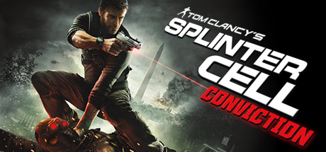

**Splinter Cell Conviction is the most action-heavy entry in the series, following a rogue Sam Fisher using aggressive stealth, the Mark and Execute system, and environmental interrogations to unravel a conspiracy tied to his daughter's apparent death.**

---

## 📖 About

Splinter Cell Conviction is the most action-heavy entry in the series, following a rogue Sam Fisher using aggressive stealth, the Mark and Execute system, and environmental interrogations to unravel a conspiracy tied to his daughter's apparent death.

## ⚠️ Problems Without Trainer

| Problem | Status |
|---------|--------|
| **Mark and Execute Limit** — Must earn executes through hand-to-hand takedowns before using | ✅ Solved |
| **Tribunal Co-op** — Co-op campaign has different timeline requiring separate completion | ✅ Solved |
| **Sticky Grenade Timing** — EMP sticky camera placements require exact positioning | ✅ Solved |
| **Last Known Position** — Enemies flanking your LKP requires adaptive repositioning | ✅ Solved |

## ✅ Solution

The **Tom Clancy's Splinter Cell Conviction Trainer** solves all these issues by giving you complete control over the game.

## 🎯 Full Feature List

- Unlimited Resources
- God Mode / Invincibility
- Instant Skill Cooldown
- One-Hit Kill
- Freeze Game Timer
- Unlock All Items & Achievements
- Custom Speed Multiplier
- Save State Anywhere

## 🚀 Quick Start

1. **Disable Windows Defender** temporarily (trainer may trigger false positive)
2. Download the trainer from the button above
3. Launch Tom Clancy's Splinter Cell Conviction
4. Run the trainer as Administrator
5. Activate desired cheats with hotkeys

## 💎 Free vs Paid

| Feature | Free | Pro |
|---------|------|-----|
| Basic God Mode | ✅ | ✅ |
| Unlimited Resources | ✅ | ✅ |
| All Advanced Cheats | ❌ | ✅ |
| Auto-Updates | ❌ | ✅ |
| Priority Support | ❌ | ✅ |

## 💻 Requirements

- Windows 10/11 (64-bit)
- Tom Clancy's Splinter Cell Conviction (any version)
- .NET Framework 4.8+
- DirectX 11+

## 🍎 macOS

macOS users can use our alternative tool:

## ⚖️ Legal

This trainer is for educational and single-player use only. Use responsibly.

---

